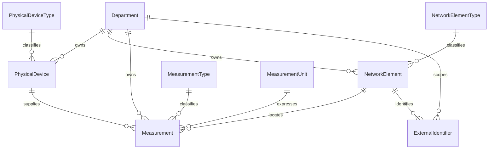

# Database and migration handover

Argyris Fellas, updated 15 November 2026. PostgreSQL 16/PostGIS is required. This contribution adds no Customer entity, Device hierarchy, User, Role or API-key model.

## Schema and boundaries

`MetadataRecord` supplies timestamps and creator/updater/archive actor fields. `DepartmentRecord` adds Department ownership, name and description. The four controlled-list models extend that base and belong to the configured Platform Department. Operational records belong to the selected business Department.



Each Measurement has exactly one Device, Network Element, Measurement Type and Measurement Unit. Optional customer/meter accounts are text fields. Optional collection configuration is JSONB. Network Elements have optional text DMA/Strategic IDs. Geometry uses SRID 4326; Device location is Point and Network geometry accepts Point, LineString or Polygon.

`METADATA_DEPARTMENT_MODEL` is swappable. The current `local_departments.Department` is a local fixture boundary because the base repository has no shared Department model. The initial metadata migration depends on the configured model. Chrystaleni must align that setting and dependency with the shared app before the first team-database migration; changing the setting after migrations have been applied is not a database migration strategy. The existing Django user model is referenced through `AUTH_USER_MODEL`.

## Validation and integrity

| Rule | Enforcement |
| --- | --- |
| Required links exist | Non-null protected foreign keys and API field validation. |
| Measurement parents belong to its Department | API scope plus composite PostgreSQL foreign keys in migration 0002. |
| Controlled values belong to Platform and are active | Serializer querysets restricted to the Platform Department and active rows. |
| Names within a controlled list are unique while active | Case-insensitive conditional database uniqueness and API validation. |
| Active external `(department,source,value)` is unique across Network Elements in that Department | Conditional database uniqueness in 0005, scoped serializer checks and collision handling. Exact string comparisons; another Department may reuse the same pair. |
| Identifier ownership matches its Network Element | Non-null Department FK and composite PostgreSQL FK `(department_id,network_element_id)` in 0005. |
| Network geometry has a supported type | Database check constraint and GeoJSON validation. |
| Coordinates are valid WGS84 and polygons valid | API GeoJSON validation; PostGIS fields use SRID 4326. |
| Deletion preserves history | Archive fields, protected references and active-dependent checks. |

Application writes run inside transactions. They lock the owning Department before validating and saving relationships. Controlled-list edits take an exclusive transaction advisory lock; ordinary writes take its shared counterpart. This prevents a concurrent list archive from invalidating an accepted relationship. Same-Department identifier collisions return field or Excel-row validation errors; different Departments can claim the same pair independently. The unique index also protects against direct writers bypassing application locks. Direct SQL/ORM writers must respect the service invariants; not all active-state rules are SQL constraints.

## Migration sequence

| Migration | Purpose |
| --- | --- |
| `local_departments.0001_initial` | Swappable local fixture Department. |
| `metadata.0001_initial` | Metadata tables, geometry and initial constraints. |
| `metadata.0002_measurement_department_constraints` | Composite same-Department foreign keys. |
| `metadata.0003_externalidentifier_created_by_and_more` | Actor audit fields and optional account/model identifiers. |
| `metadata.0004_identifier_system_uniqueness` | Replace per-element external-pair uniqueness with active `(source,value)` uniqueness. |
| `metadata.0005_identifier_department_scope` | Backfill identifier Departments from their parents, replace global uniqueness with active `(department,source,value)` uniqueness, and enforce matching parent ownership. |

Existing committed migrations are preserved. Migration 0004 does not delete or merge records. If earlier branch versions have already stored the same active pair on different Network Elements, inspect and resolve those duplicates with the data owner before applying 0004. This read-only preflight identifies them:

```sql
SELECT source, value, COUNT(*) AS active_count
FROM metadata_externalidentifier
WHERE deleted_at IS NULL
GROUP BY source, value
HAVING COUNT(*) > 1;
```

Run from `backend/` with the configured PostGIS development database:

```sh
python manage.py check
python manage.py migrate --plan
python manage.py migrate --noinput
python manage.py makemigrations --check --dry-run
python -m pytest -v
```

The database test role needs permission to create the separate test database. The project's `TEST.TEMPLATE` is `template_postgis`, so that template must exist with the PostGIS extension installed; the configured PostGIS Docker image supplies it. The existing CI creates an isolated PostGIS service and executes these checks.

Migration 0005 preserves all existing identifier rows, including archived history, IDs, strings, timestamps and actors. It derives `department_id` from the parent and makes it non-null. Ordinary ORM saves infer the value when omitted; bulk/SQL writers must supply the matching Department. Nested API identifier objects still accept only `source` and `value`; no ownership input or new endpoint is exposed.

Only in a disposable database, `python manage.py migrate metadata 0004` reverses 0005 and `python manage.py migrate metadata 0005` reapplies it. Reversal restores global uniqueness and therefore fails atomically if the newly permitted cross-Department duplicates exist. It does not delete or merge them. Review those rows with the data owner and follow the agreed backup/deployment procedure before any downgrade. The migration test verifies both lossless backfill/reapplication and safe refusal of a conflicting downgrade. Do not unapply 0003 to shared data because it adds stored fields.

For an existing database still at 0003, the unchanged migration 0004 remains an intermediate step and requires its historical global-duplicate preflight above. Do not fake or rewrite applied migrations to skip that check. New empty databases and databases already at 0004 can advance through 0005 normally. This work ran migrations only in isolated local/test databases.

## Historical records

`deleted_at IS NULL` means active. Normal querysets use `.active()`. Archive changes `deleted_at`, `deleted_by`, `updated_at` and `updated_by`; it preserves primary keys, parents and original creator. Archiving a Network Element also archives its external identifiers. An identifier removed from a replacement list remains stored. There is no user-facing hard-delete or restore endpoint.

The backend's tests validate archival and concurrent writes on PostGIS. Authentication, production Department memberships, roles, API keys and shared User/Department migrations remain Chrystaleni's integration work.
