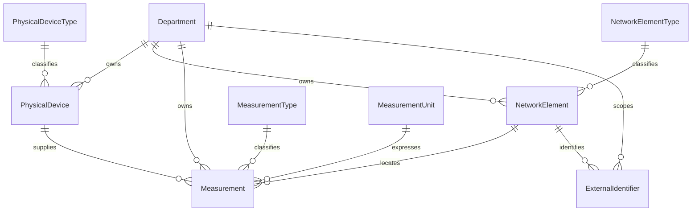

# Database and migration handover

Argyris Fellas, updated 17 November 2026. This proposed documentation update covers PR #32; source revisions and deployment prerequisites are stated below. PostgreSQL 16/PostGIS is required. This contribution adds no Customer entity, Device hierarchy, User, Role or API-key model.

## Schema and boundaries

`MetadataRecord` supplies timestamps and creator/updater/archive actor fields. `DepartmentRecord` adds Department ownership, name and description. The four controlled-list models extend that base and belong to the configured Platform Department. Operational records belong to the selected business Department.



Each Measurement has exactly one Device, Network Element, Measurement Type and Measurement Unit. Optional customer/meter accounts are text fields. Optional collection configuration is JSONB. Network Elements have optional text DMA/Strategic IDs. Geometry uses SRID 4326; Device location is Point and Network geometry accepts Point, LineString or Polygon.

`METADATA_DEPARTMENT_MODEL` is swappable. The current `local_departments.Department` is a local fixture boundary because the base repository has no shared Department model. The initial metadata migration depends on the configured model. Chrystaleni must align that setting and dependency with the shared app before the first team-database migration; changing the setting after migrations have been applied is not a database migration strategy. The existing Django user model is referenced through `AUTH_USER_MODEL`.

## Validation and integrity

| Rule | Enforcement |
| --- | --- |
| Required links exist | Non-null protected foreign keys and API field validation. |
| Measurement parents belong to its Department | API scope plus composite PostgreSQL foreign keys in migration 0002. |
| Controlled values belong to Platform and are active | Serializer querysets restricted to the Platform Department and active rows. |
| Names within a controlled list are unique while active | Case-insensitive conditional database uniqueness and API validation. |
| Active external `(department,source,value)` is unique across Network Elements in that Department | Conditional database uniqueness in original 0005 or the PR #32 replacement, scoped serializer checks and collision handling. Exact string comparisons; another Department may reuse the same pair. |
| Identifier ownership matches its Network Element | Non-null Department FK and composite PostgreSQL FK `(department_id,network_element_id)` in original 0005 or the PR #32 replacement. |
| Network geometry has a supported type | Database check constraint and GeoJSON validation. |
| Coordinates are valid WGS84 and polygons valid | API GeoJSON validation; PostGIS fields use SRID 4326. |
| Deletion preserves history | Archive fields, protected references and active-dependent checks. |

Application writes run inside transactions. They lock the owning Department before validating and saving relationships. Controlled-list edits take an exclusive transaction advisory lock; ordinary writes take its shared counterpart. This prevents a concurrent list archive from invalidating an accepted relationship. Same-Department identifier collisions return field or Excel-row validation errors; different Departments can claim the same pair independently. The unique index also protects against direct writers bypassing application locks. Direct SQL/ORM writers must respect the service invariants; not all active-state rules are SQL constraints.

## Migration history and PR #32 upgrade runbook

This runbook documents PR #32 at `e4fa5de50f0bdeec81526e329792e673e7ae3f67`. On 17 November 2026 that PR is open; published main `2f97a90c6d1bef8301aff68c03b5b0b9130e3d65` still contains only the original migrations. Confirm the checked-out revision before choosing a path.

| Migration | Purpose |
| --- | --- |
| `local_departments.0001_initial` | Swappable local Department boundary. |
| `metadata.0001_initial` | Metadata tables, geometry and initial constraints. |
| `metadata.0002_measurement_department_constraints` | Composite same-Department Measurement foreign keys. |
| `metadata.0003_externalidentifier_created_by_and_more` | Actor audit fields and account/model identifiers. |
| Original `0004_identifier_system_uniqueness` | Historical global active `(source,value)` uniqueness. |
| Original `0005_identifier_department_scope` | Identifier Department backfill, scoped uniqueness and matching-parent composite FK. |
| PR #32 `0004_squashed_0005_identifier_department_scope` | Replaces the original 0004/0005 pair without introducing their intermediate global-uniqueness constraint. |

The original migration files remain unchanged. Keep them alongside the replacement: Django needs the original path for partially applied histories. Do not fake applied migrations, edit migration records manually, or delete the old files as part of this upgrade.

### Select the path from the actual migration history

These are the normal Django migration paths when the PR #32 replacement file is present:

| Starting history | Expected plan and result |
| --- | --- |
| Through 0003, neither original 0004 nor 0005 applied | Apply the replacement directly. Existing active pairs reused across Departments are valid and preserved. Same-Department active duplicates reject the migration atomically. |
| Original 0004 applied, original 0005 not applied | Django uses the original 0005 to finish the partially applied pair. Do not force the replacement operations to run on top of 0004. |
| Both original 0004 and 0005 applied | The final schema is already present. Normal migrate recognizes the completed replaced history and records the replacement alias; it does not repeat the schema operations. |
| Fresh database | Apply the initial migrations through 0003, then the replacement. The resulting schema matches the current models. |

Without PR #32, an existing database at 0003 still encounters the historical global constraint in original 0004. Cross-Department duplicate pairs can make that intermediate step fail even though they are valid in the final model. A green fresh-database CI run does not establish that this older-data upgrade succeeds.

Django selects replacement migrations from their `replaces` attribute and the database migration history. See [Django 5.2 squashing documentation](https://docs.djangoproject.com/en/5.2/topics/migrations/#squashing-migrations).

### Preconditions and backup

1. Confirm the source revision, the configured `METADATA_DEPARTMENT_MODEL` and the agreed shared User/Department integration. Changing a swappable model setting after applying migrations is not a migration plan.
2. Take a recoverable full database backup, including application tables and `django_migrations`. Include deployment configuration and required role/extension information in the team's backup procedure. Keep backups outside version control.
3. Verify restoration into a separate PostgreSQL/PostGIS database. Run the preflight and inspect the migration plan on that restored copy before an approved shared deployment.
4. Record identifier IDs, parent/Department IDs, source/value pairs, active/archived counts, actors and timestamps so they can be compared after the upgrade.
5. Agree a deployment window or write freeze, the responsible operator and the recovery procedure. This document does not authorize a shared-database migration.

### Read-only duplicate preflight

For the replacement/final Department-scoped rule, look for active duplicates within the same parent Department. Deriving ownership from the Network Element makes this query usable before the identifier Department column exists:

```sql
SELECT element.department_id, identifier.source, identifier.value,
       COUNT(*) AS active_count
FROM metadata_externalidentifier AS identifier
JOIN metadata_networkelement AS element
  ON element.id = identifier.network_element_id
WHERE identifier.deleted_at IS NULL
GROUP BY element.department_id, identifier.source, identifier.value
HAVING COUNT(*) > 1;
```

Any returned same-Department group requires an explicit data-owner decision before applying the final scoped constraint. The migration does not delete, merge or archive those records automatically.

The same pair in different Departments is permitted. Do not remove legitimate cross-Department reuse to satisfy the replacement path.

For diagnosing original 0004 or considering a downgrade to its global rule, this different query identifies global collisions:

```sql
SELECT source, value, COUNT(*) AS active_count
FROM metadata_externalidentifier
WHERE deleted_at IS NULL
GROUP BY source, value
HAVING COUNT(*) > 1;
```

The global query is not the acceptance criterion for the replacement upgrade.

### Inspect and verify on an isolated copy

From `backend/`, point the environment at the restored/disposable PostGIS database:

```sh
python manage.py check
python manage.py showmigrations metadata
python manage.py migrate --plan
```

Compare the displayed path with the starting-history table. Only on that isolated copy, apply and validate:

```sh
python manage.py migrate --noinput
python manage.py showmigrations metadata
python manage.py makemigrations --check --dry-run
python -m pytest -v
```

The test role needs permission to create a separate test database. The configured `TEST.TEMPLATE` is `template_postgis`; it must contain PostGIS. The project's PostGIS Docker image provides that template.

After migration, verify:

- Active and archived identifiers retain their IDs, parent IDs, strings, audit fields and timestamps.
- Every identifier Department equals its Network Element Department, including archived rows.
- `meta_active_dept_external_identifier` enforces active `(department,source,value)` uniqueness.
- `meta_identifier_element_department` enforces the matching-parent composite FK.
- Cross-Department reuse succeeds; same-Department active duplication and mismatched ownership are rejected.
- `makemigrations --check --dry-run` reports no model-state drift.

Ordinary ORM saves derive omitted identifier ownership from the parent. Bulk/SQL writers must supply the matching Department. API/Excel identifiers keep their existing nested shape; clients do not supply identifier ownership.

### Rollback limitations

Rollback depends on the path actually applied:

- Reversing original 0005 to original 0004 restores global uniqueness. It fails atomically if the final schema has accepted the same active pair in different Departments. The existing regression test verifies preservation of data and the applied migration after this refusal.
- Reversing the complete PR #32 replacement to 0003 restores the earlier per-element uniqueness rule and removes its added Department column/FK. The replacement regression test verifies preservation of the original identifier rows and audit fields during that path.
- These are different rollback paths. Inspect the real graph/history rather than copying an abbreviated `migrate metadata 0004` command: both an original and a replacement migration have that prefix.
- Do not unapply 0003 against shared data as a workaround; it contains stored fields.
- Do not delete legitimate identifiers or alter migration history to force a downgrade. Resolve any conflict with the data owner and use the agreed recovery plan and verified backup.

Exercise a chosen rollback only on an isolated restored database before agreeing any persistent-database action.

### Existing regression coverage

PR #32 adds `metadata/tests/test_identifier_upgrade.py`:

| Test | Evidence |
| --- | --- |
| `test_original_0004_rejects_cross_department_pairs_atomically` | Reproduces the historical intermediate failure and verifies unchanged data/history/index. |
| `test_replacement_preserves_active_and_archived_identifiers_and_reverses` | Verifies 0003 upgrade, retained rows/audit, scoped uniqueness, composite FK and reverse to 0003. |
| `test_replacement_rejects_same_department_duplicates_atomically` | Verifies refusal without partial schema/data/history changes. |
| `test_existing_original_migration_history_is_supported` | Covers original-0004 and original-0005 starting histories. |
| `test_fresh_metadata_install_matches_models` | Covers fresh replacement install and model-state consistency. |

The migration tests' historical loader/recorder helpers are confined to disposable test databases. They are not production migration commands.

## Historical records

`deleted_at IS NULL` means active. Normal querysets use `.active()`. Archive changes `deleted_at`, `deleted_by`, `updated_at` and `updated_by`; it preserves primary keys, parents and original creator. Archiving a Network Element also archives its external identifiers. An identifier removed from a replacement list remains stored. There is no user-facing hard-delete or restore endpoint.

The backend's tests validate archival and concurrent writes on PostGIS. Authentication, production Department memberships, roles, API keys and shared User/Department migrations remain Chrystaleni's integration work.
